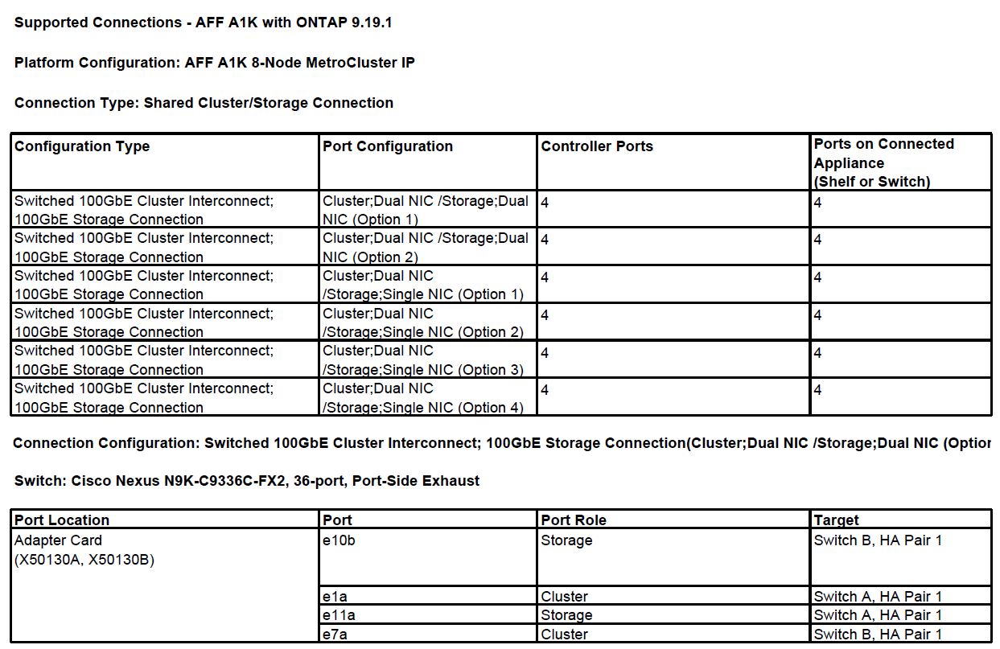

= How to cable your MetroCluster IP switches
:icons: font
:imagesdir: ../media/

[.lead]
You must understand how to use the information in the NetApp hardware universe to correctly generate your RCF files.

.Before you begin

Review these considerations before cabling the switches:

*  The same cabling is used for site A and site B.
* You cannot configure the switches with ports of different speeds (for example, a mix of 100 Gbps ports and 40 Gbps ports).
* Keep track of the MetroCluster port group (MetroCluster 1, MetroCluster 2, etc.). You'll need this information when using the RcfFileGenerator tool as described later in this configuration procedure.
* You should cable all of the nodes in the same way. If there are different port combination options available to cable the nodes, all nodes should use the same port combinations. For example, e1a on node1 and e1a on node2 should be attached to one switch. Similarly, the second port from both nodes should be attached to the second switch. 

== Step 1: Gather cabling information

. Navigate to the link:https://hwu.netapp.com/DetailViews/Home.aspx[Hardware Universe^]
. Select your platform type from the *Products* tab, and then select your specific platform and whether you are cabling a four-node or eight-node MetroCluster IP configuration.
. Select the ONTAP version from the display window and then select *Show results*.
. Select *Supported connections* and then select the switch type in the display window.
+
You can now gather the information for cluster interconnect, MetroCluster-over-IP, shared cluster/storage and storage connections. 
+
You can choose to export the information in each tab to a PDF or excel. The following example shows the PDF output for Shared Cluster/Storage connections for cabling an AFF A1K system to a 36-port Cisco Nexus N9K-C9336C-FX2 switch in an eight-node MetroCluster IP configuration:
+

== Step 2: Verify your cabling using the RCFfilegenerator tool

The https://mysupport.netapp.com/site/tools/tool-eula/rcffilegenerator[RcfFileGenerator for MetroCluster IP^] tool also provides a per-port cabling overview for each switch.
You can use this cabling overview to verify your cabling.

For information on using the RcfFileGenerator tool, refer to link:https://kb.netapp.com/on-prem/ontap/mc/MC-KBs/How_to_use_the_RCF_Generator_for_MetroCluster_IP[How to use the RCF Generator for MetroCluster IP^]

== Cabling two MetroCluster configurations to the switches

When cabling more than one MetroCluster configuration to a switch, you cable each MetroCluster according to the appropriate table. For example, if you are cabling a FAS2750 and an AFF A700 to the same switch, you cable the FAS2750 as per "MetroCluster 1" in Table 1, and the AFF A700 as per "MetroCluster 2" or "MetroCluster 3" in Table 2. You cannot physically cable both the FAS2750 and the AFF A700 as "MetroCluster 1".

== Cabling eight-node MetroCluster configurations

For MetroCluster configuration running ONTAP 9.8 and earlier, some procedures that are performed to transition an upgrade require the addition of a second four-node DR group to the configuration to create a temporary eight-node configuration.  Beginning with ONTAP 9.9.1, permanent eight-node MetroCluster configurations are supported.

.About this task

For eight-node configurations, you use the same method as described above. Instead of a second MetroCluster, you are cabling an additional four-node DR group. 

For example, your configuration includes the following:

* Cisco 3132Q-V switches
* MetroCluster 1: FAS2750 platforms
* MetroCluster 2: AFF A700 platforms (these platforms are being added as a second four-node DR group)

.Steps

. For MetroCluster 1, cable the Cisco 3132Q-V switches using the table for the FAS2750 platform and the rows for MetroCluster 1 interfaces.

. For MetroCluster 2 (the second DR group), cable the Cisco 3132Q-V switches using the table for the AFF A700 platform and the rows for MetroCluster 2 interfaces.

// 2024 Dec 09, ONTAPDOC-2349
// 21 APR 2021, BURT 1374268
